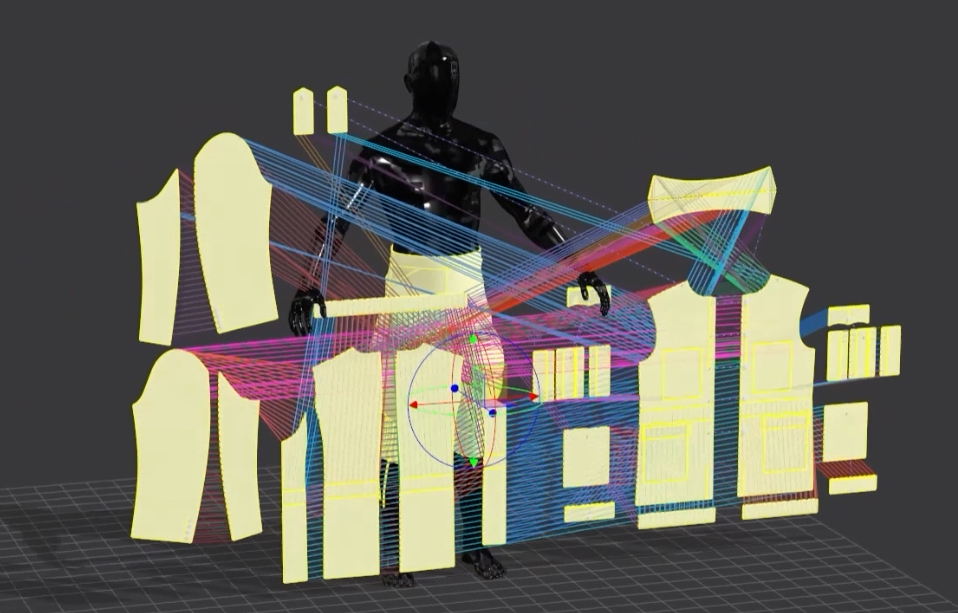

# My Project

A 3D scan of the West Midlands Police Museum

## Description

This repository contains patterns for making replica hostoric police uniforms spanning 200 years in the Birmingham and West Midlands area.

These files were produces as part of the part the Fashion Police Project during 2024 and 2025.  The project was funded by The National Lottery Heritage Fund.

More information on the project can be found at https://www.fashion-police.co.uk/.

## Format

DXF format

## License

This work made available under the Creative Commons Attribution 4.0 International (CC BY 4.0) licence, unless otherwise stated.

